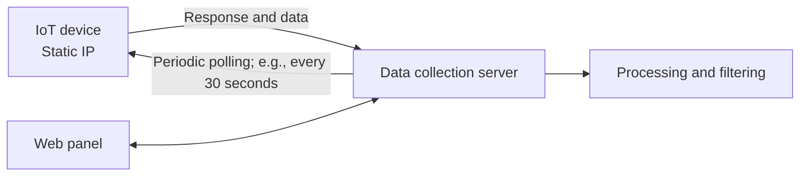
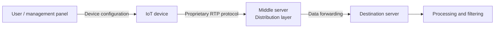

<h1 align="center">iziot</h1>

Technical overview of the IoT system architecture

This repository contains software components and documentation for a system that receives, transfers, and processes data from Internet of Things (IoT) devices. During development, the device-to-server communication architecture evolved through three approaches.

> **Note:** The development history and attribution described in this document are based on the developer's account.

## Table of Contents

- [Architectures](#architectures)
  - [1. Polling a Static IP Address](#1-polling-a-static-ip-address)
  - [2. Direct Device-to-Server Data Transmission](#2-direct-device-to-server-data-transmission)
  - [3. Distribution Layer and RTP Protocol](#3-distribution-layer-and-rtp-protocol)
- [Technical Notes](#technical-notes)
- [Ownership and Development History](#ownership-and-development-history)

## Architectures

### 1. Polling a Static IP Address

In the initial version, each device was reachable over a SIM-card or Wi-Fi internet connection and had a static IP address. Device details, such as its name and IP address, were registered in the management panel. At scheduled intervals, the server connected to the device, retrieved its data, and passed it on for processing and filtering.

The first version of this approach was implemented as a simple .NET script and was later rewritten and extended.

### 2. Direct Device-to-Server Data Transmission

In this architecture, devices are registered in the management panel, which assigns each device a Base64-encoded configuration value. The value is provided to the device during configuration and contains information such as the device name and destination server address. The device then sends its data to the server over HTTPS for processing and filtering.

### 3. Distribution Layer and RTP Protocol

This architecture extends the direct-transmission approach by adding an intermediate server (middle server). The device sends data to the middle server using the proprietary RTP (Reza Transfor Protocol); the middle server then forwards the data to the destination server for processing.

## Technical Notes

- MQTT is not used in the third architecture. The technical rationale for this choice is not covered in this document.
- According to the developer, RTP communication uses a proprietary encryption mechanism. Its implementation details are not included in this README.
- **Base64 is not encryption.** In the second architecture, Base64 is used to represent or transfer configuration data and should not be considered a confidentiality mechanism on its own.
- The diagrams are conceptual representations of data flow; they do not show implementation details, network settings, or encryption internals.

## Ownership and Development History

According to the developer, the project's implementations and changes were maintained in personal GitHub repositories under the username [`rezafarazi`](https://github.com/rezafarazi) and a personal email address. The developer also states that Vaya Media did not provide a repository or version-control system as a record of the project's development.
