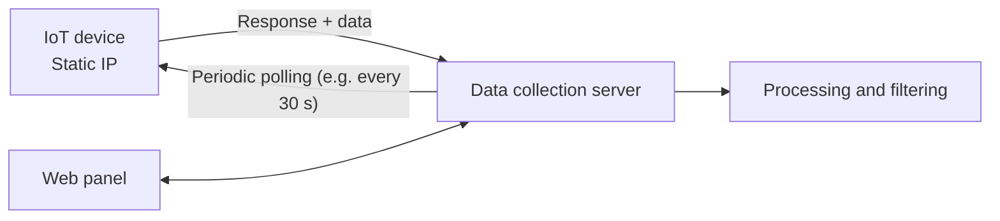

<div align="center">

<!--  -->

# iziot

**An end-to-end IoT platform: from a GPS/GSM/camera device in the field to a live map in your browser.**

Custom lightweight transport protocol · Spring Boot backend · Leaflet.js live map · Docker-ready


</div>

---

## Overview

**iziot** is a complete stack for receiving, transferring and processing data from remote IoT devices. It covers every layer:

- **Device firmware**: ESP32-CAM + NEO-6M GPS + SIM800L GSM modem
- **Transport**: HTTPS and a custom protocol (**RTP – Reza Transfer Protocol**) built for constrained, cellular links
- **Distribution layer**: a middle server that decouples devices from processing
- **Backend**: Spring Boot service for ingestion, processing and filtering
- **Frontend**: live device tracking on a Leaflet.js map
- **Deployment**: Docker

The project is also a record of how the device-to-server architecture evolved through three generations, each solving a limitation of the previous one.

## Features

- 📍 Real-time GPS tracking with fix detection (status shown via LED blink patterns)
- 📷 Chunked image streaming from ESP32-CAM over unreliable cellular links
- 🔐 Payload obfuscation/encryption inside RTP
- 🧩 Three interchangeable communication architectures
- 🗺️ Web map frontend built on Leaflet.js
- 🐳 Docker deployment
- 🪵 File-based debug logging on-device (useful when the serial port is occupied by connected modules)

## Hardware

| Component | Role |
|-----------|------|
| ESP32-CAM | Main MCU, camera |
| NEO-6M | GPS receiver |
| SIM800L | GSM/GPRS connectivity |

> ⚠️ **Power warning:** the SIM800L needs a stable 3.4–4.4 V supply with high peak current (~2 A bursts). Double-check polarity on every module before powering up — reverse polarity will destroy a GPS/GSM module.

<!-- TODO: add wiring diagram / pin table (docs/wiring.png) -->

## Architecture

The system went through three generations.

### v1 — Polling a static IP

Each device had a static IP (SIM or Wi-Fi) and was registered in the management panel. The server polled devices on a schedule, collected their data and passed it on for processing. The first version was a simple .NET script, later rewritten and extended.



**Limitation:** requires a reachable static IP per device. This is expensive and often impossible on cellular networks.

### v2 — Direct device-to-server over HTTPS

Devices are registered in the panel, which issues a Base64-encoded configuration string (device name, destination server, etc.). The device is flashed/configured with it and pushes data to the server over HTTPS.


**Limitation:** HTTPS/TLS is heavy for small MCUs on slow GPRS links, and every device is tied directly to the processing server.

### v3 — Distribution layer + RTP (current)

A middle server is added. Devices speak **RTP** to it, and it forwards data to the destination server.


Benefits: lighter on-device protocol, the processing backend can change or scale without touching device firmware, and the middle layer can handle routing, buffering and load.

## RTP — Reza Transfer Protocol

A custom, lightweight protocol designed for constrained devices on slow, unreliable links. MQTT is intentionally not used in v3.

- Chunked transfer, so large payloads (such as camera frames) survive weak connections
- Built-in payload protection

<!-- TODO: add the packet/frame layout (header fields, chunk index, length, checksum), handshake, and retry behavior. Even a small table makes this section far more valuable. -->

> **Security note:** Base64 (v2 configuration) is an encoding, **not** encryption. Likewise, a custom or XOR-style cipher provides obfuscation rather than strong confidentiality. For sensitive deployments, run RTP inside an authenticated, standard cipher (e.g. AES-GCM / ChaCha20-Poly1305 with per-device keys).

## Repository structure

```
iziot/
├── Hub/                          # <!-- TODO: one-line description -->
├── Char/                         # <!-- TODO: one-line description -->
├── IziotServiceBySpring/         # Spring Boot backend
├── RTP (Reza Transfor Protocol)/ # Protocol implementation / spec
├── Logo/                         # Branding assets
├── iziotDocker                   # Docker deployment
├── LICENSE
└── README.md
```

## Getting started

### Prerequisites

- JDK 17+ and Maven/Gradle (backend)
- Docker (optional)
- `esptool` / `mpremote` or Thonny (firmware flashing)

### 1. Run the backend

```bash
cd IziotServiceBySpring
./mvnw spring-boot:run
```

or with Docker:

```bash
docker build -t iziot -f iziotDocker .
docker run -p 8080:8080 iziot
```

<!-- TODO: confirm commands, port, and required environment variables -->

### 2. Flash the firmware

```bash
esptool.py --chip esp32 --port /dev/ttyUSB0 erase_flash
esptool.py --chip esp32 --port /dev/ttyUSB0 write_flash -z 0x1000 <micropython-firmware>.bin
mpremote connect /dev/ttyUSB0 cp -r firmware/ :
```

> ESP32-CAM boards have no USB chip: use an FTDI adapter and hold **GPIO0 → GND** while resetting to enter flash mode.

### 3. Register a device

1. Open the management panel and add a device.
2. Copy the generated configuration value.
3. Provide it to the device (config file / provisioning step).
4. Power the device and wait for a GPS fix (LED pattern indicates status).

## Configuration

| Setting | Description |
|---------|-------------|
| Server address | Middle/destination server host and port |
| Device name / ID | Unique identifier registered in the panel |
| APN | Cellular APN for the SIM800L |
| Shared key | Per-device key used by RTP |

> Never commit real keys, APNs credentials, Wi-Fi passwords or server secrets. Use a `config.example.*` file and keep the real one in `.gitignore`.

## Roadmap

- [ ] Publish RTP specification (frame format + test vectors)
- [ ] Replace custom/XOR cipher with an authenticated standard cipher
- [ ] OTA firmware updates
- [ ] Device health telemetry (battery, signal strength)
- [ ] Alerts and geofencing in the web UI

## Contributing

Issues and pull requests are welcome. Please open an issue first for larger changes.

## License

Released under the [MIT License](LICENSE).

## Author

**Reza** — founder of [izino](https://github.com/realizino)

🌐 [rezafta.ir](https://rezafta.ir)